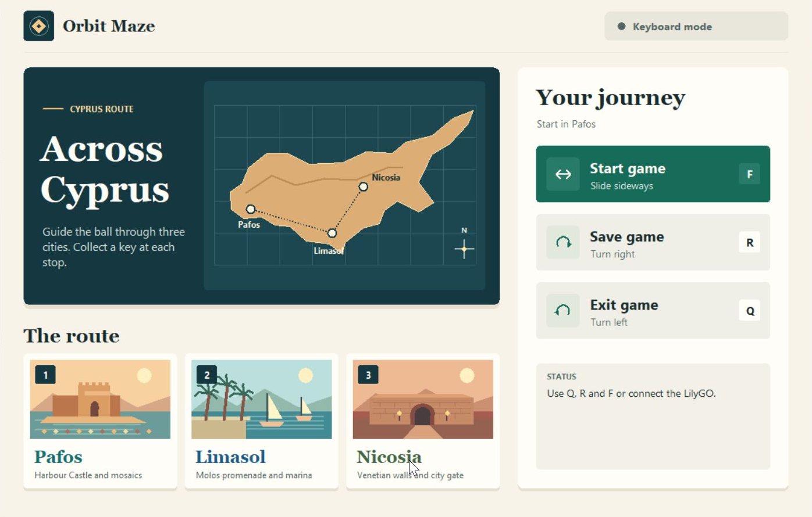

# Orbit Maze

Orbit Maze is an EPL428 Internet of Things project by Pablo Valdes. A LilyGO T-Beam S3 Supreme reads its onboard accelerometer and gyroscope, classifies motion on the ESP32-S3, and displays the class on its OLED. The Windows desktop game uses the same USB sensor stream to turn or advance a ball through Pafos, Limasol and Nicosia.

[Project report (PDF)](docs/Orbit%20Maze%20Project%20Report.pdf) · [Setup and reproduction guide](START_HERE.md) · [Training run](results/20261123T144139418921Z) · [Gesture calibration](data/game_calibration/20261124T110855947669Z)



## Run the game on Windows

From the repository root, use Python 3.12 with Tk support. In PowerShell, run:

```powershell
py -3.12 -m venv .venv
.\.venv\Scripts\python.exe -m pip install -r requirements-lock.txt
.\.venv\Scripts\python.exe .\pc\maze.py --keyboard
```

Press **F** or **Enter** to start. In a level, **Q** and **R** turn left and right. **F** moves one tile in the arrow's direction and **Esc** opens the menu. Collect the key and reach the exit in each city. The Nicosia lantern patrol adds a timing challenge.

In the main menu, click a city card or press **1**, **2** or **3** to select an unlocked level. Pafos unlocks Limasol when completed, and Limasol unlocks Nicosia. Selecting a locked city shows what to complete. The game remembers unlocks as soon as each level is cleared.

### Play wirelessly with the LilyGO

Upload the current firmware once using a USB data cable. Power the LilyGO with a compatible battery or a USB power bank for a wireless demo. Connect the PC to the board's **OrbitMaze** Wi-Fi network with the demo password `orbit-maze-428`, then launch the game in Wi-Fi mode:

```powershell
.\.venv\Scripts\python.exe .\pc\maze.py --wifi
```

Hold the board level until **Wi-Fi • Ready** appears. The board sends raw IMU samples and its on-device predictions over TCP to the same gesture detector used for USB play. The OLED keeps displaying the latest classification.

### Play with the LilyGO over USB

Connect a LilyGO T-Beam S3 Supreme with the supplied firmware, then run `maze.py` without `--keyboard`. Install the [PlatformIO IDE](https://platformio.org/install/ide?install=vscode) if you need to flash the firmware. From the repository root, use `pio run -e t-beams3-supreme` to build and `pio run -e t-beams3-supreme -t upload --upload-port BOARD_PORT` to upload, substituting the port from `capture.py --list`. Close Serial Monitor before starting the game. Let the board settle horizontally with its OLED facing up until **Ready** appears.

| Physical input | In the maze | In the menu |
| --- | --- | --- |
| Slide sideways | Advance one tile along the arrow | Start or continue |
| Turn left | Aim 90° left | Exit |
| Turn right | Aim 90° right | Save |
| Tilt up and hold | Open the menu | — |

Hold the board still between gestures. The gesture profile in `data/orbit_profile.json` was selected on the recorded device and operator. Use keyboard mode for a hardware-free walkthrough.

The lantern in Nicosia uses the player's successful moves to estimate a next tile. It can reverse its patrol toward that tile on the marked corridor. The game keeps up to 256 movement transitions in the local save. After clearing Nicosia, hold still and slide once to start a new route from Pafos.

## Data and results

| Evidence | Location |
| --- | --- |
| Labeled accelerometer and gyroscope readings | [`data/raw`](data/raw) |
| Session split, model comparison and held-out confusion matrix | [`results/20261123T144139418921Z`](results/20261123T144139418921Z) |
| Live OLED observations and serial predictions | [`data/demo`](data/demo) |
| Short game gestures, recorded signals and profile comparison | [`data/game_calibration`](data/game_calibration) |

Six complete sessions yielded **47,522 samples**. A depth-3 tree selected by training-session cross-validation reached **0.977 mean macro F1** and correctly classified **78/78 windows** in one held-out session. The desktop controller's final profile recognized **6/6 reserved trials** in replay after the startup correction. Its median decision time was **140 ms**, compared with **190 ms** for the previous timing profile using the corrected startup logic. Both evaluations used the same operator and board.

To reproduce the training run from the supplied data:

```powershell
.\.venv\Scripts\python.exe .\pc\training.py --test-session 20261123T143823802862Z
```

Training writes a new results directory. The optional `--export` flag also replaces the active firmware model. The supplied firmware already includes the validated model.

## Source and credits

- `student/05_Project` contains Arduino firmware, feature extraction and the exported tree.
- `pc` contains the recorder, trainer, hardware demo and Tk desktop game.
- `boards` and `lib` contain the LAB03 board definition and versioned dependencies. See [the provenance manifest](PROVENANCE.json) and the licenses in the individual library directories.
- The firmware builds on EPL428 LAB03 `02_Motion` and `03_Dashboard`. The desktop application and illustrations were developed for this project. The [setup guide](START_HERE.md#5-play-orbit-maze) links to the landmarks that inspired the artwork.
